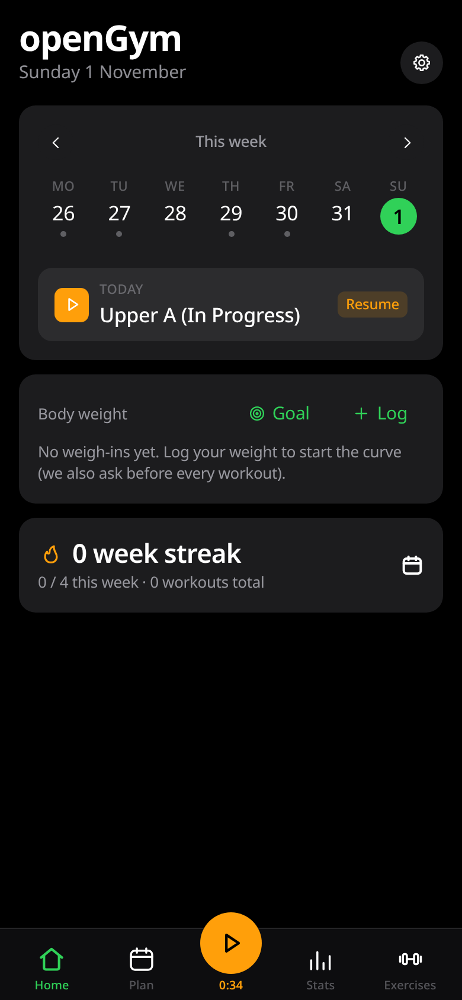
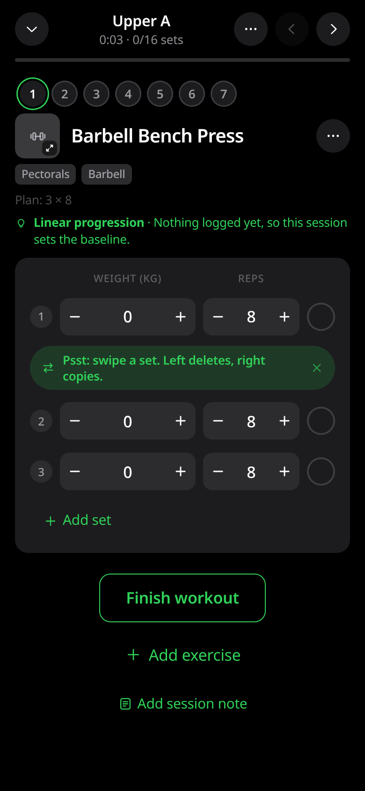
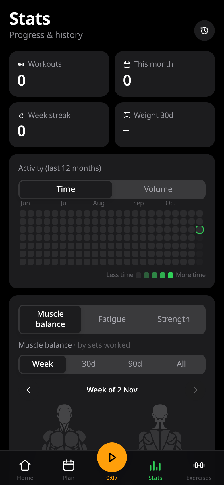
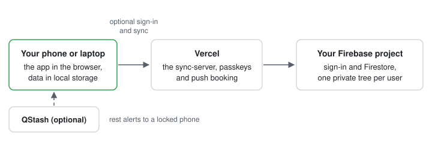
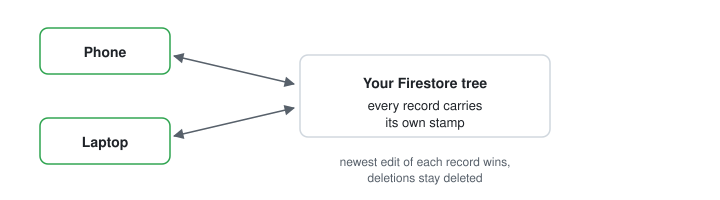

# opengym-lean

A leaner fork of [openGym](https://github.com/DuarteSantos8/openGym). Same workout tracker, less of everything else.

 
 
   

**Live: [opengym-lean.vercel.app](https://opengym-lean.vercel.app)**

<table align="center">
<tr>
<td align="center"> <b>Home</b> · today and the week at a glance</td>
<td align="center"> <b>Guided workout</b> · sets, reps and progression</td>
<td align="center"> <b>Stats</b> · activity heatmap and muscle balance</td>
</tr>
</table>

This is my own project built on top of openGym. It is not part of the upstream app and it is not the official version. I liked openGym, so I stripped it down to the parts I actually use and made it plug and play: open it and train. No server, no account, no setup. If you want your data synced across devices, you can link your own Firebase project with a short guided setup.

---

## How it differs

Same app underneath. The differences are what got taken out and how sync works.

| | openGym | opengym-lean |
|---|---|---|
| First open | Demo data loaded | Starts empty |
| Gym check-in card | Built in | Removed |
| AI Coach screens | Built in | Removed |
| Admin dashboard | Built in | Removed |
| To run it | Self-host with Docker | Just open the site |
| Sync (optional) | Its own server | Your own Firebase + Vercel |
| Rest alerts, phone locked | Server push | Optional QStash push |

---

## Use it

**Just open it.** Go to the live site, add it to your home screen, and train. Everything runs in your browser, your data stays in your browser, and it starts empty, with none of the demo data the original ships.

**Or sync it.** Follow [SETUP-SYNC.md](SETUP-SYNC.md) to connect your own free Firebase project and deploy the small sync backend to Vercel. Sign in with a passkey or with Google, and your plans and history follow you between phone and laptop. Your data lives in your Firebase project, under your account, not on anyone else's server.

[](https://vercel.com/new/clone?repository-url=https%3A%2F%2Fgithub.com%2F0xovo%2Fopengym-lean&project-name=opengym-lean&repository-name=opengym-lean&root-directory=sync-server&env=FIREBASE_SERVICE_ACCOUNT%2CWEBAUTHN_RP_ID%2CWEBAUTHN_ORIGIN%2CVITE_FB_API_KEY%2CVITE_FB_PROJECT_ID%2CVITE_FB_APP_ID&envDescription=All+values+come+from+your+own+Firebase+project+%28SETUP-SYNC.md%2C+Part+1%29.+FIREBASE_SERVICE_ACCOUNT+is+the+service+account+JSON+pasted+as+one+value.+WEBAUTHN_RP_ID+is+your+Vercel+domain+as+a+bare+host+%28your-project.vercel.app%29+and+WEBAUTHN_ORIGIN+is+the+same+domain+with+https%3A%2F%2F+in+front.+VITE_FB_API_KEY%2C+VITE_FB_PROJECT_ID+and+VITE_FB_APP_ID+come+from+the+firebaseConfig+block+of+your+web+app.&envLink=https%3A%2F%2Fgithub.com%2F0xovo%2Fopengym-lean%2Fblob%2Fmain%2FSETUP-SYNC.md)

---

## How it works

Two modes, one app. Local mode never leaves the device; sync mode adds your own Firebase behind the same screens.

In sync mode your data is split into small documents inside your own tree, `users/<your-id>/`, one per collection (routines, workouts, settings, and so on), because Firestore caps a single document at 1 MiB. Nobody else's data sits next to yours, and the security rules lock each tree to its owner.

Edits made offline are kept on the device and merged when it reconnects; nothing is thrown away for being offline.

---

## What I removed

- The gym check-in card and its QR code flow.
- The AI Coach screens and settings.
- The admin dashboard and the first-launch onboarding screens.
- Photos and videos attached to finished workouts.
- The Docker self-hosting stack, and the demo data. This fork starts empty.
- Dead weight in general: a Settings row offering an Android APK this fork does not ship, glow and ping effects on buttons, and copy that promised things a web app cannot do.

---

## What I added

| Added | What it does |
|---|---|
| Firebase sync (optional) | Bring your own free Firebase project; sign in with a passkey or Google and your plans and history follow you between devices. |
| Sign-in methods | A Settings card to link a Google account and add or remove a passkey, with a guard so you can never remove your last way in. |
| Rest alerts without a server | A notification on the device when a rest ends; with a free QStash account it can also be booked ahead and pushed to your locked phone. |

Setup for both lives in [SETUP-SYNC.md](https://github.com/0xovo/opengym-lean/blob/main/SETUP-SYNC.md).

---

## What stayed the same

Workout logging, routines and weekly plans, stats, history, the exercise library, measurements, progress photos, and backup export and import. The app itself is Duarte Santos's openGym and full credit stays with him. This fork is AGPL-3.0 like the original, see [NOTICE.md](NOTICE.md).

---

## Support

If this fork saved you a subscription, you can buy me a coffee: [ko-fi.com/0xovo](https://ko-fi.com/0xovo). Updates land on X first: [@0xovoo](https://x.com/0xovoo).

---

Built on <a href="https://github.com/DuarteSantos8/openGym">openGym</a> by Duarte Santos. Fork and changes AGPL-3.0.

